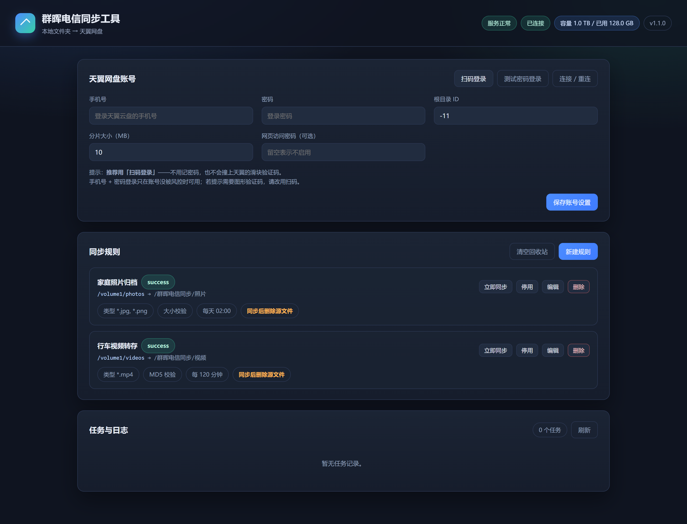
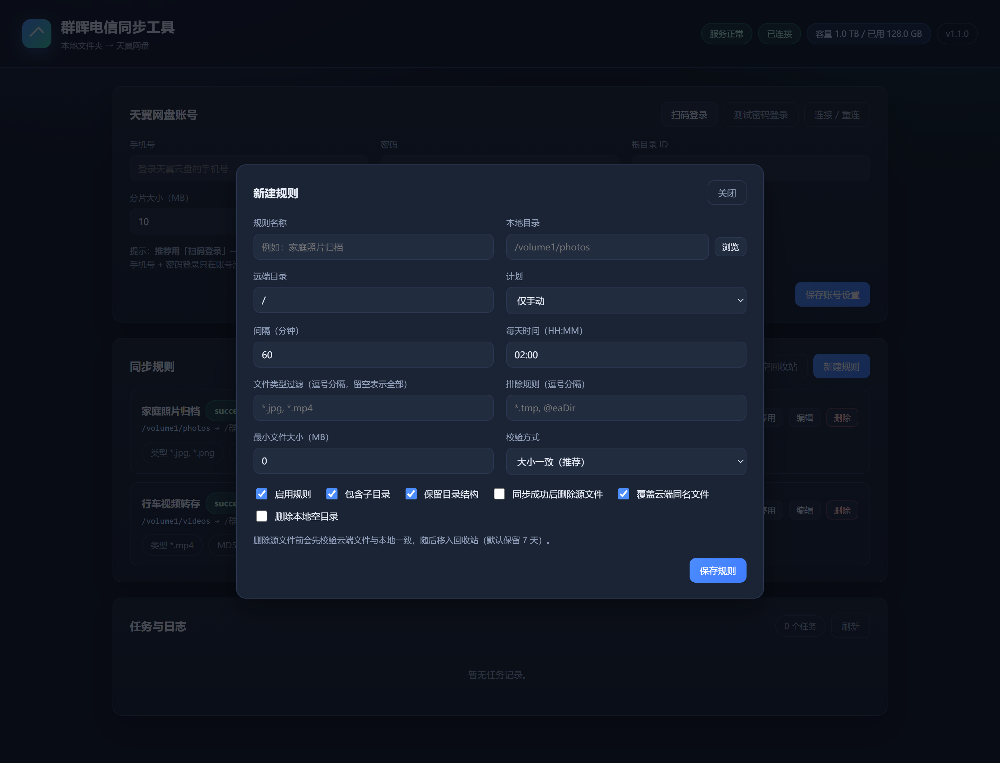
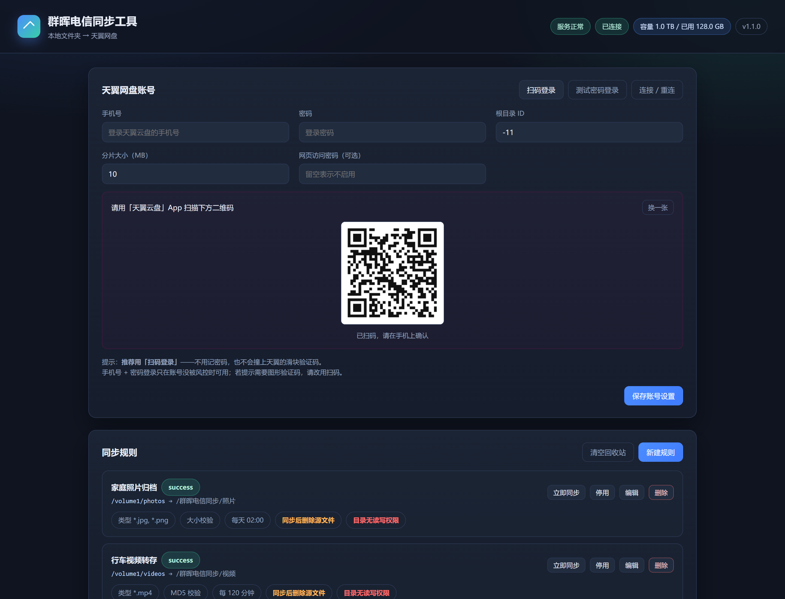

# 群晖电信同步工具（QunHuiSync）

群晖 NAS 套件（SPK）：把群晖上的**本地文件夹**同步到**天翼网盘**（Cloud189）。

- 支持按**文件类型**过滤（`*.jpg`、`*.mp4` …），也可以整目录同步
- 支持**保留/打平目录结构**
- 同步成功后可**删除源文件**（校验通过后直接删除，无回收站）
- 支持**定时计划**（每 N 分钟 / 每天固定时间）与手动触发
- **大文件自动分段上传**（单次请求 < 900MB，突破网盘 2GB 单请求上限），**并发上传**（线程数 1-8 可调）
- 界面实时显示**每个文件**的进度与**上传速度**，可**单独取消某个文件**
- 自带 Web 管理界面，无需 SSH 即可配置

> **DSM 7 起套件以非特权账号运行**（官方强制要求，未签名套件不允许以 root 运行），
> 同步目录需要单独授权，详见下方「三、目录权限授权」。

---

## 一、安装

### 1. 安装 Python 3

套件中心 → 安装 **Python 3**（需 3.8 及以上，推荐 3.9+）。套件自带 `httpx`、
`pycryptodome` 等依赖，无需另外安装。

### 2. 安装本套件

在「套件中心 → 安装套件」中选择与你的 NAS 架构匹配的包，勾选「安装后运行」。

```
qunhuisync_x86_64-7.2_1.4.4-0013.spk     Intel / AMD 群晖
qunhuisync_armv8-7.2_1.4.4-0013.spk      ARM64 群晖（DS920+ 等）
```

> 下载：仓库右侧 **Releases** → 下载与你的 NAS 架构匹配的那个 `.spk`（附 `.sha256` 校验文件）。

> 查看 NAS 架构：控制面板 → 信息中心 → 硬件，或 SSH 执行 `uname -m`（`x86_64` / `aarch64`）。

> **升级**：版本号每次变更都会递增（1.0.0 → 1.1.0 → …）。直接在套件中心
> 「安装套件 → 上传」新包即可，DSM 会识别为升级并保留已有的账号配置与令牌，
> 不需要先卸载。版本号相同的包无法覆盖安装。

安装完成后访问：

```
http://<群晖IP>:8686/
```

如需挂到 DSM 自己的域名下，可在 SSH 下执行（可选）：

```sh
sudo /var/packages/qunhuisync/scripts/add-proxy.sh
```

之后访问 `http://<群晖IP>/webman/3rdparty/qunhuisync/`。
（也可以用 DSM 的「控制面板 → 登录门户 → 高级 → 反向代理」自行添加，更稳妥。）

---

## 二、首次配置

1. 打开 Web 界面 →「天翼网盘账号」→ 右上角点「**扫码登录**」
   - 页面出现二维码，用手机上的「**天翼云盘**」App 扫描并确认
   - 右上角状态条变成「已连接」即成功
   - 登录状态会保存，套件重启后自动续期，不用重新扫码
2. 「保存账号设置」
3. 「新建规则」
   - **本地目录**：群晖上的路径，如 `/volume1/photos`
   - **远端目录**：天翼网盘中的路径，如 `/群晖电信同步/照片`，不存在会自动创建
   - **文件类型过滤**：`*.jpg, *.png` 逗号分隔，留空表示全部文件
   - **同步成功后删除源文件**：打开后，仅在校验通过时才会删除
4. 点「立即同步」测试一次，任务日志会显示扫描/上传/跳过/删除数量

> **只用扫码登录**：天翼网页版的密码登录是网易易盾滑块，无法自动通过，
> 所以界面不提供密码入口。

---

## 三、目录权限授权（DSM 7 必读）

DSM 7 起，群晖要求**未签名的第三方套件不得以 root 身份运行**——套件中心会直接拒绝安装
「以 root 权限运行」的套件。因此本套件以系统内部用户 `sc-qunhuisync` 身份运行。

这带来一个后果：**新装的套件对所有共享目录都没有读写权限**，需要你手动授权一次。

### 查看哪些目录缺权限

Web 界面顶部会出现「目录权限」区块，列出权限不足的目录；每条规则卡片上也会标
「目录无读写权限」。点「重新检查」可随时刷新。

### 授权方式（任选其一）

**方式 A：DSM 界面（推荐）**

1. 控制面板 → **共享文件夹** → 选中目标目录 → **编辑**
2. 切到 **权限** 标签页
3. 在下拉框里选 **系统内部用户**
4. 找到 `sc-qunhuisync`，勾选 **读写**
5. 确定

> 若要授权某个子目录，记得给父目录加上「浏览文件夹」权限，否则无法进入。

**方式 B：SSH 一键授权**

```sh
sudo /var/packages/qunhuisync/target/scripts/grant-access.sh /volume1/photos
# 可一次传多个目录
sudo /var/packages/qunhuisync/target/scripts/grant-access.sh /volume1/photos /volume1/videos
```

脚本会用 `synoacltool` 授予读写权限，并自动处理父目录的遍历权限。

### 为什么需要这一步

「同步成功后删除源文件」需要**删除**本地文件的权限；写入回收站也需要写权限。
只有读权限的话，上传能成功，但删除源文件会失败——这时套件会保留源文件并在日志里
写明「删除源文件失败」，不会丢数据。

---

## 四、规则说明

| 选项 | 说明 |
| --- | --- |
| 本地目录 | 同步源目录，支持子目录递归 |
| 远端目录 | 网盘目标路径，不存在会自动创建 |
| 文件类型过滤 | 支持 `*.jpg`（按文件名）、`子目录/*.mp4`（按相对路径）、`**/*.png`（任意层级）；大小写不敏感 |
| 排除规则 | 命中即跳过，例如 `*.tmp` |
| 排除目录 | 默认 `@eaDir`、回收站目录，可自行增删 |
| 保留目录结构 | 关闭后所有文件平铺到远端目录 |
| 最小文件大小 | 跳过小于指定体积的文件，单位可选字节 / KB / MB / GB |
| 删除 0 字节文件 | 空文件**本地直接删除**，不上传 |
| 校验方式 | **大小一致**（默认）；**MD5 强校验**会回读云端文件计算哈希，流量翻倍；**不校验**不建议 |
| 同步成功后删除源文件 | 校验通过后**直接删除**源文件（无回收站，删了就没了） |
| 覆盖云端同名文件 | 云端存在同名但大小不同的文件时，先删除再上传 |
| 删除本地空目录 | **全部文件上传完成后**清理空目录（含上传过程中因删除源文件而变空的目录） |
| 计划 | 仅手动 / 每 N 分钟 / 每天 HH:MM |

### 增量与重复文件

- 每次同步都会记录「文件大小 + 修改时间」，未变化的文件直接跳过，不会重复上传。
- 若本地记录丢失（例如重装），会退化为按「云端同名且大小一致」判断，同样不会重复上传。

### 关于删除源文件的安全性

1. 上传完成后重新读取云端目录，核对文件名与大小；
2. 若选择 MD5 校验，再回读云端文件计算 MD5 与本地比对；
3. 校验通过才删除源文件，校验不通过会**保留源文件**并在日志中标注。

> ⚠ **本套件没有回收站**：源文件删除后无法找回。
> 请先关闭该开关跑一次，确认上传结果无误后再打开。

### 上传方式

按 OpenList 的 `189pc` 机制走天翼的**整文件上传**接口。

天翼的对象存储前端是 nginx，**单次请求体超过 2GB 会直接被挡掉**（413）。
因此套件会把大文件**分段 PUT**（每段 < 900MB），每段传完查一次
`getUploadFileStatus` 拿到服务端**实际已登记的字节数**，从那个位置继续传下一段。
这样 4GB / 6GB 甚至更大的文件都能正常上传。

传输中断时同样按服务端登记的位置**从断点继续**，不会重头再来。

界面「当前任务」面板会列出**每个并发文件**，各自显示文件名、已传 / 总量、
**实时速度**、独立进度条，以及独立的「取消此文件」按钮。点「取消」会**立即中断**，
不用等当前文件传完。

---

## 五、命令行用法

套件把应用与依赖都放在 `target` 目录下，使用时加上 `PYTHONPATH` 即可：

```sh
export PYTHONPATH=/var/packages/qunhuisync/target/deps:/var/packages/qunhuisync/target/app
export QHS_CONFIG=/var/packages/qunhuisync/var/config/config.json

# 检查配置与依赖
python3 -m qunhuisync check --config /var/packages/qunhuisync/var/config/config.json

# 手动执行一次同步（all 表示所有规则）
python3 -m qunhuisync sync --config /var/packages/qunhuisync/var/config/config.json --rule all

# 启动服务（套件一般自动启动，手动启动请先停掉套件）
python3 -m qunhuisync serve --config /var/packages/qunhuisync/var/config/config.json --port 8686
```

查看日志：`/var/log/packages/qunhuisync.log`，或在套件中心点「服务状态 → 日志」。

### 文件位置

| 路径 | 内容 |
| --- | --- |
| `/var/packages/qunhuisync/var/config/config.json` | 账号与规则配置（权限 600） |
| `/var/packages/qunhuisync/var/config/token.json` | 天翼网盘登录令牌，自动续期 |
| `/var/packages/qunhuisync/var/config/state.json` | 同步状态（已同步文件记录） |
| `/var/log/packages/qunhuisync.log` | 运行日志（DSM 7 路径） |
| `/var/packages/qunhuisync/target/scripts/grant-access.sh` | 目录授权脚本（需 root 执行） |

---

## 六、常见问题

**登录报「账号未连接」**
点右上角「扫码登录」，用天翼云盘 App 扫一次即可。登录状态会保存，重启后自动续期。

**提示「需要图形验证码」**
天翼网页版的密码登录已换成网易易盾**滑块**，无法自动通过。
本套件只用扫码登录，不提供密码入口。

**扫码后一直提示「请使用天翼云盘 App 扫码」**
确认扫的是「天翼云盘」App（不是中国电信 App），并在手机上点了「确认登录」。
二维码有效期约 2 分钟，过期了点「换一张」。

**上传很慢或中断**
套件可在账号设置里调整「上传线程数」（默认 2）；大文件建议用 MD5 校验以外的
「大小校验」。传输中断时套件会自动从断点续传。

**超过 2GB 的大文件传不上去**
旧版本会因为天翼单次请求 2GB 上限（413）反复重传。新版本已改为分段上传
（每段 < 900MB），并从服务端登记的位置续传。6GB 文件实测可正常上传，MD5 与本地一致。

**网页打不开，提示「密码错误」**
若在账号设置里填了「网页访问密码」，打开页面后会弹出密码框，输入即可。
若页面直接显示一句「密码错误」，说明浏览器缓存里存的是旧密码——清一下缓存
或在密码框里重新输入。

**文件传上去了但本地没删掉**
套件会在下一轮同步补删。若删除失败（权限不足 / 文件被占用），日志里会写明
「删除源文件失败」，修好权限后重跑一次即可。

**目录名带 emoji 建不出来**
天翼拒绝带 emoji 的目录名（`EmojiArgumentError`）。套件会自动把目录名和文件名
里的 emoji 替换掉再上传。

**界面报「刷新失败：Cannot read properties of undefined」或反代 502**
旧版本 `/api/state` 会同步调用网盘接口，网络慢时接口被拖死，
反代超时返回 502，界面随之崩掉。1.4.1 已改为后台刷新容量、接口立即返回。

**文件删了能找回来吗**
不能。本套件已取消回收站机制，校验通过后源文件直接删除。
重要数据请先备份，或先跑一次不开「删除源文件」的同步确认结果。

**端口 8686 被占用**
修改 `/var/packages/qunhuisync/var/config/port` 的内容，或在 `config.json` 中改 `server.port`，然后在套件中心重启套件。

**想先确认能不能连通网盘**
在界面点「测试登录」，或命令行执行 `python3 -m qunhuisync check`。

**提示「以 root 权限运行，因此无法安装」**
这是 DSM 7 的强制检查。本套件已改为 `run-as: package`（服务账号 `sc-qunhuisync`），
若仍出现，说明装的是旧版本包，请先删除旧包再装新版。

**同步没反应 / 日志报「Permission denied」**
服务账号没有该目录的权限，见「三、目录权限授权」。界面顶部会列出缺权限的目录。

**能上传但删不掉源文件**
只有读权限时上传能成功，但删除需要写权限。授权后重试即可；失败时套件会保留源文件，不会丢数据。

---

## 七、从源码构建 SPK

### 快速开始

```sh
./build.sh                            # Linux / macOS / 群晖 SSH
python build/build_spk.py             # Windows（需 Python 3.8+）
```

产物（按架构各一个，DSM 官方要求不同平台的二进制不能打进同一个包）：

```
dist/qunhuisync_x86_64-7.2_1.4.4-0013.spk    Intel / AMD 群晖
dist/qunhuisync_armv8-7.2_1.4.4-0013.spk     ARM64 群晖（DS920+ 等）
```

同时生成同名 `.sha256` 校验文件。

> **安装时请选与你的 NAS 架构匹配的包**。查看 NAS 架构：控制面板 → 信息中心 → 硬件，或 `uname -m`（`x86_64` / `aarch64`）。

### 发新版本（升级安装）

DSM 不允许同版本号覆盖安装，所以每次改动都要**递增版本号**再出包：

```sh
python build/build_spk.py --set-version 1.2.0
```

`--set-version` 会同时改写 `spk/INFO` 和 `src/qunhuisync/__init__.py`（构建时会校验两者一致，
不一致直接报错），并把版本号写进产物文件名。

用户侧：直接在套件中心上传新包即可，DSM 识别为升级，**已有的账号配置与令牌会保留**。

### 全部参数

| 参数 | 说明 |
| --- | --- |
| （无参数） | 完整构建：拉取依赖 → 组装 → 打包 → 校验 |
| `--offline` | 不联网，使用 `build/wheels` 里的缓存 |
| `--arch x86_64` | 只打包指定架构，可重复指定。默认 `x86_64, aarch64` |
| `--set-version 1.2.0` | 先把版本号同步到 `spk/INFO` 和 `__init__.py` 再构建 |
| `--clean` | 清理 `build/package`、`build/wheels` 等中间产物 |
| `--no-validate` | 跳过构建后的包结构校验 |
| `--keep-stage` | 保留 `build/package` 暂存目录，便于排查 |

### 构建流程

```
校验版本号一致性 → 检查 BOM → 下载依赖 → 组装内层 package.tgz
    → 生成图标 → 写 INFO → 打包外层 spk → 计算 sha256 → 校验包结构
```

### DSM 7 规范符合性

本项目的打包严格对照[官方开发者指南](https://help.synology.com/developer-guide/synology_package/introduction.html)与官方工具包实现（`pkg_make_spk` / `pkg_make_package`）：

| 项目 | 官方要求 | 本项目 |
| --- | --- | --- |
| **SPK 归档格式** | **未压缩 tar**（官方 `tar cpf`），文档原文「SPK file in tar format」 | ✓ |
| **顶层路径** | 内容直接位于归档根目录，**无 `package/` 前缀** | ✓ |
| `package.tgz` | 必须有，TGZ 格式，解压后落在 `target/` | ✓ |
| `conf/privilege` | DSM 7 **强制**，文件名单数 | ✓ |
| `PACKAGE_ICON.PNG` | DSM 7 要求 **64×64** | ✓ RGBA |
| `PACKAGE_ICON_256.PNG` | 必须有，**256×256** | ✓ RGBA |
| `arch` | 必填 | ✓ `x86_64` / `armv8` |
| `os_min_ver` | DSM 7 需 ≥ `7.0-40000` | ✓ |
| `version` | `feature-build` 格式 | ✓ `1.0.0-0001` |
| `checksum` | `package.tgz` 的 MD5 | ✓ 构建时写入并校验 |
| 多语言描述 | `description_chs` / `description_cht` | ✓ |
| 脚本可执行位 | `scripts/` 下需为 755 | ✓ |
| 文件名格式 | `<包名>_<架构>-<DSM版本>_<版本>-<build>.spk` | ✓ |

### 构建脚本做了什么

| 环节 | 说明 |
| --- | --- |
| 版本号单一来源 | `--set-version` 同时改写 `spk/INFO` 与 `src/qunhuisync/__init__.py`；两者不一致时**直接报错**，避免装出版本错乱的包 |
| BOM 检查 | `INFO`、`privilege`、shell 脚本、Python 源码带 UTF-8 BOM 时中止构建——群晖解析带 BOM 的 INFO 会失败 |
| 依赖分层 | 纯 Python 依赖与该架构的 `pycryptodome` 一起封装进 `package.tgz`，解压后落在 `target/deps/` |
| 按架构分包 | 官方要求「不要把不同平台的二进制打进同一个 spk」，因此 x86_64 与 armv8 各出一个包 |
| 依赖纯净性 | 通用依赖目录里出现 `.so`/`.pyd` 时中止构建——架构不匹配会在 NAS 上直接崩 |
| 缺失拦截 | 纯 Python 依赖下载失败即硬失败，不产出残缺包 |
| 可复现打包 | 固定 gzip 头时间戳、tar 成员的 mtime/uid/gid 与顺序，**同样输入产出字节一致的文件** |
| 自动校验 | 构建后调用 `validate_spk.py` 检查 INFO 字段、脚本可执行位、图标尺寸、依赖完整性、checksum |

### 架构支持

| DSM 架构名 | 加密库 | 对应机型 |
| --- | --- | --- |
| `x86_64` | 预编译 | Intel / AMD 群晖 |
| `armv8` | 预编译 | ARM64 群晖（DS920+ 等） |
| `armv7` | **无** | pycryptodome 官方不发布 Linux armv7 轮子（3.21.0 与 4.2.0 均无），armv7 机型需自行编译或换机型 |

### 目录说明

```
src/qunhuisync/     应用代码（服务端 + Web 界面）
spk/                SPK 骨架（INFO / conf/privilege / conf/resource / scripts / app）
build/              构建、图标生成、包校验、安装模拟、截图脚本
build.sh            Linux/macOS 构建入口
tests/              单元测试
docs/               使用说明、功能清单、界面截图
dist/               构建产物（.spk + .sha256）
```

### 校验与测试

```sh
python build/validate_spk.py                    # 校验 dist 下所有包
python build/validate_spk.py dist/xxx.spk       # 校验指定包
python build/simulate_install.py dist/xxx.spk   # 模拟安装：解包 -> 解压 -> 启动服务
pip install -r requirements.txt pytest
python -m pytest tests -q
```

---

## 八、界面预览

| 总览 | 新建规则 | 扫码登录 |
| --- | --- | --- |
|  |  |  |

更多截图（目录浏览、任务日志、目录权限提示）见 [docs/README.md](docs/README.md)。

---

## 九、说明

- 套件以系统内部用户 `sc-qunhuisync` 运行（DSM 7 强制降权），同步目录需单独授权。
- 天翼网盘没有官方开放 API，本项目按 OpenList `189pc` 驱动的方式调用网页版接口，接口变动可能导致失效。
- 重要数据请先自行备份，开启「删除源文件」前建议先跑一次不删除的同步确认结果。
- `pycryptodome` 为 C 扩展，armv7 机型无预编译包（详见上文架构支持）。
