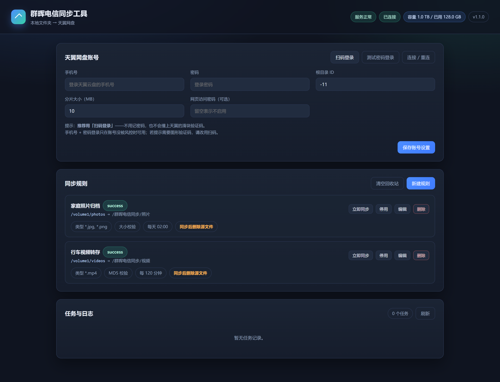
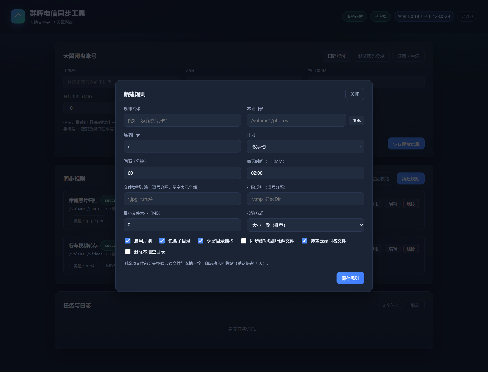
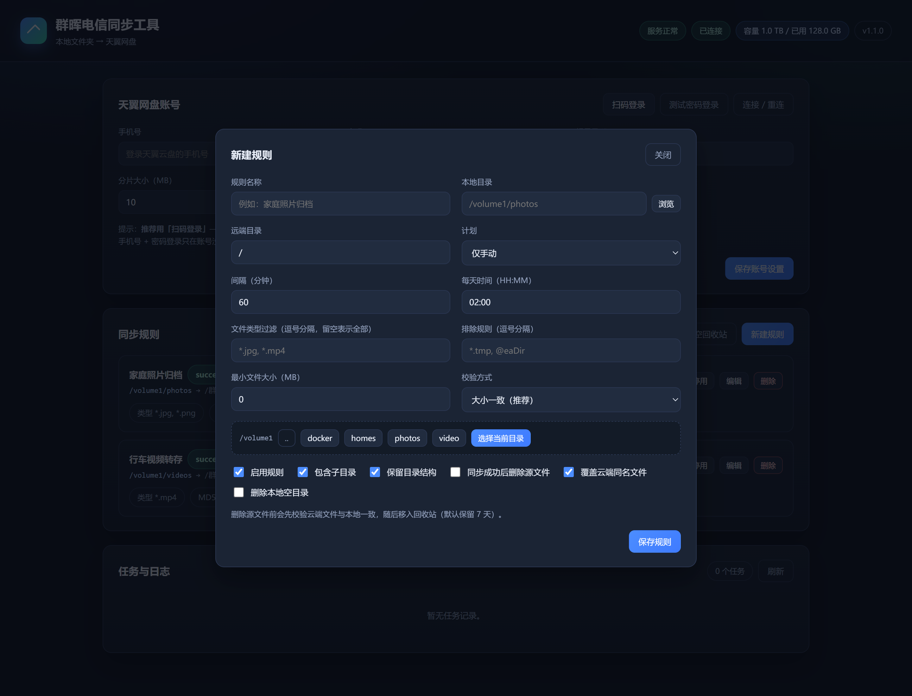
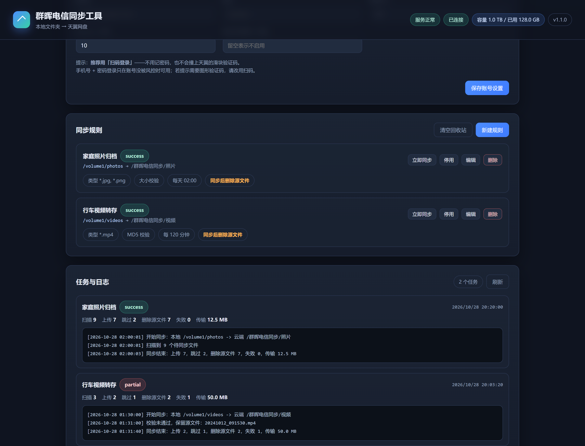
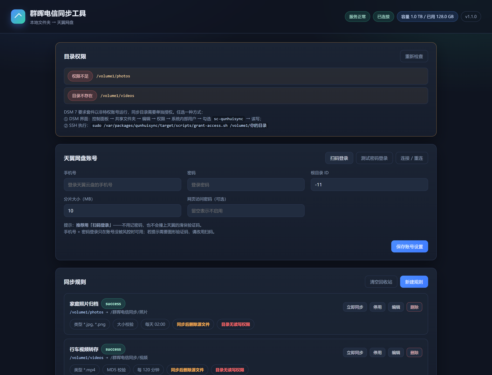
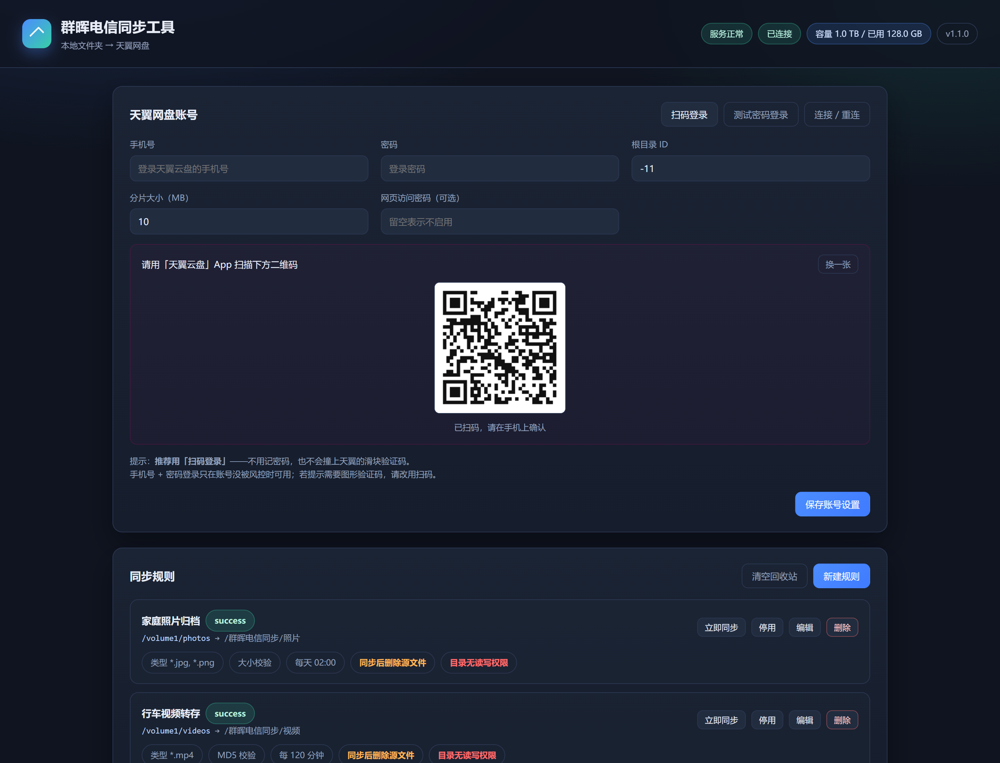

# 群晖电信同步工具 · 文档与截图

群晖 NAS 套件，把本地文件夹同步到天翼网盘，支持校验一致后删除源文件。

## 文档

| 文档 | 内容 |
| --- | --- |
| [功能清单.md](功能清单.md) | 全部功能一览，含能力边界 |
| [使用说明.md](使用说明.md) | 安装、配置、日常使用、常见问题 |
| [../README.md](../README.md) | 项目总览与从源码构建说明 |

## 界面截图

### 1. 总览

账号面板、同步规则列表、任务日志三块区域。规则卡片上直接标出类型过滤、校验方式、执行计划和「同步后删除源文件」开关。



### 2. 新建规则

一条规则的全部选项：本地/远端目录、执行计划、文件类型过滤、排除规则、最小体积、校验方式，以及「同步成功后删除源文件」等开关。



### 3. 本地目录浏览

点「浏览」后在群晖文件系统里逐级选择同步目录，不用手打路径。



### 4. 任务与日志

每次同步的统计（扫描/上传/跳过/删除源文件/失败/传输量）与逐行日志。校验不通过时日志会明确写出「校验未通过，保留源文件」。



### 5. 目录权限提示

DSM 7 要求套件以非特权账号运行，新装的套件对共享目录没有读写权限。界面会在这里列出缺权限的目录，并给出 DSM 界面授权与 SSH 一键授权两种做法。



### 6. 扫码登录

账号面板右上角点「扫码登录」，界面会显示天翼官方下发的二维码，用「天翼云盘」App 扫描即可登录 —— 不用记密码，也不会撞上天翼的滑块验证码。



## 重新生成截图

```sh
pip install playwright
python build/shoot.py http://127.0.0.1:8687/ docs
```

脚本用 Playwright 驱动系统已安装的 Edge/Chrome，无需额外下载浏览器内核。
截图在 Windows 上拍摄，脚本会拦截「目录浏览」和「权限检查」两个接口，
换成群晖上的典型路径（`/volume1/...`），因此图里不会出现 Windows 目录。
